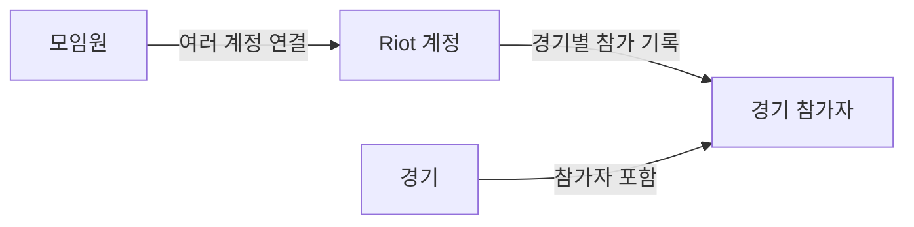

# 내부 구조

[문서 목록](README.md) · [개발·테스트](development.md)

LLVY는 Next.js의 화면·서버 기능과 PostgreSQL을 사용합니다.
원본 리플레이는 Vercel Blob에 보관하며 Redis는 조회와 자동완성의 선택적 캐시입니다.

## 코드 위치

| 위치                                                                                                                 | 역할                           |
| -------------------------------------------------------------------------------------------------------------------- | ------------------------------ |
| [`src/app/`](../src/app/)                                                                                            | 화면, Server Actions, API      |
| [`src/db/schema.ts`](../src/db/schema.ts)                                                                            | 데이터 모델과 제약조건         |
| [`src/lib/rofl/`](../src/lib/rofl/)                                                                                  | 리플레이 메타데이터 파싱       |
| [`src/lib/ingest.ts`](../src/lib/ingest.ts)                                                                          | 파싱한 경기와 참가자 저장      |
| [`src/lib/member-mutations.ts`](../src/lib/member-mutations.ts), [`game-mutations.ts`](../src/lib/game-mutations.ts) | 권한을 확인한 모임원·경기 변경 |
| [`src/lib/read-model.ts`](../src/lib/read-model.ts)                                                                  | 화면에 필요한 조회 결과 구성   |
| [`src/lib/session.ts`](../src/lib/session.ts)                                                                        | 로그인 세션과 역할 확인        |
| [`src/test/`](../src/test/)                                                                                          | 테스트용 데이터와 공통 설정    |

## 데이터 관계

- 리플레이에서 발견한 Riot 계정은 처음에는 모임원에 연결되지 않습니다. 관리자가 연결합니다.
- 모임원 전적은 현재 연결된 모든 Riot 계정의 경기를 합산합니다. 계정 연결을 바꾸면 과거 전적에도 반영됩니다.
- 제외한 경기는 목록과 통계에서 빠지지만 원본과 기록은 보존되어 복구할 수 있습니다.
- Discord 로그인 계정은 게임 모임원과 별도로 관리합니다. 이름으로 두 계정을 자동 연결하지 않습니다.

구체적인 테이블은 [`schema.ts`](../src/db/schema.ts), 전적 집계는
[`member-history.ts`](../src/lib/member-history.ts)에서 확인할 수 있습니다.

## 업로드 흐름

1. 업로더·관리자·오너가 업로드를 시작하면 서버가 파일을 올릴 경로와 업로드 권한을 발급합니다.
2. 브라우저가 원본을 Blob에 직접 업로드합니다.
3. 서버가 업로드 소유권과 현재 사용자 권한을 확인한 뒤 파일을 읽고 파싱합니다.
4. 경기·참가자와 감사로그를 저장합니다. 중복 파일은 기존 경기로 안내합니다.

PUUID·Riot 게임 이름·태그는 앞뒤 공백 제거 후 각각 UTF-8 512바이트까지 허용합니다.
파서와 저장 전 예산 검사가 이 한도를 초과한 식별자를 잘라내지 않고 거부해 DB 인덱스 오류를 방지합니다.
웹·앱 모두 422 및 `invalid_replay` 실패 감사로 처리하며 경기·계정·참가자를 저장하지 않습니다.
웹은 해당 Blob 정리를 즉시 시도하고, 앱은 만료 후 정기 정리 작업에 위임합니다.
기존 PUUID 누락·빈 태그 및 파일 해시 중복 처리 동작은 유지합니다.

게임 버전과 챔피언 이름은 각각 UTF-8 256바이트, 원본 파일명은 1,024바이트로 제한합니다.
진단용 JSON에서 큰 문자열을 제외하는 것과 별개로 실제 저장 필드에 적용하며, 초과 값은 잘라내지 않고 같은 실패 경로로 거부합니다.
파일명은 중복 처리 전에 검사하므로 중복 업로드의 감사에도 제한 없는 입력이 전달되지 않습니다.

시작과 처리는 [`src/app/api/`](../src/app/api/), 저장은
[`ingest.ts`](../src/lib/ingest.ts), 미사용 업로드 정리는
[`expired-upload-cleanup.ts`](../src/lib/expired-upload-cleanup.ts)에서 처리합니다.

## 조회와 검색

화면은 조회 모델을 통해 경기·모임원 정보를 읽습니다. 모든 로그인 역할에 기존 모임원 조회의 생년을 전달합니다. 최소 자동완성·팀 명단·관계 DTO는 그대로 유지합니다.
Redis가 연결되어 있으면 조회 결과와 이름·Riot ID 자동완성 인덱스를 캐시하고,
연결되지 않거나 장애가 나면 PostgreSQL에서 조회합니다.

업무 변경은 같은 트랜잭션에서 PostgreSQL의 관련 `cache_revisions`를 증가시킵니다.
읽기는 현재 권한과 revision을 확인한 뒤 해당 버전의 Redis 결과를 사용하므로,
모임원 목록을 하루 보관해도 회원·계정 변경 이후에는 새 결과를 읽습니다.
전적은 현재 신원, 연결 계정, 전체 통계, 경기 페이지를 나눠 다음 페이지에서 통계를 재사용합니다.
같은 팀·상대 팀 최고 승률과 최다 만남은 관계별 3경기 이상인 모임원을 대상으로
[`member-relationships.ts`](../src/lib/member-relationships.ts)의 SQL 한 개로 집계합니다.
관계 통계는 이름·계정·경기 변경에 반응하는 별도 캐시를 사용하며, 플레이 포지션 아래 한 행에
최다 팀원·최다 상대를 먼저, 최고 승률 두 항목을 뒤에 표시합니다. 화면에서는 최고 승률이
50% 이하인 블록을 숨기며, SQL과 캐시의 원본 집계 결과는 유지합니다.
정책 기본값은 비활성이며, migration과 모든 writer 전환 확인 후 활성화합니다.
TTL과 전환·복구 절차는 [Redis 안내](redis.md)를 참고하세요.

검색 제출은 현재 DB의 이름·Riot ID와 계정 연결을 확인합니다. 일치하는 모임원이 한 명이면
전적으로 이동하고, 여러 명이면 선택 목록을 표시합니다.
검색은 [`nickname-search.ts`](../src/lib/nickname-search.ts), 캐시는
[`query-cache.ts`](../src/lib/query-cache.ts)와 [`autocomplete-index.ts`](../src/lib/autocomplete-index.ts)에서 다룹니다.

## 권한과 데이터 변경

- Discord로 신원을 확인하고 지정 서버 가입 여부를 확인한 뒤 앱 세션을 만듭니다.
- 서버의 조회·API·변경 함수가 세션과 역할을 확인합니다. 화면에서 버튼을 숨기는 것만으로 권한을 제한하지 않습니다.
- 데이터 변경 직전에는 권한을 다시 확인하며, 변경과 감사로그를 같은 DB 트랜잭션에 저장합니다.
- 업로더/관리자 부여·회수는 [`account-administration.ts`](../src/lib/account-administration.ts),
  변경 작업의 공통 권한 확인과 감사는 [`audit.ts`](../src/lib/audit.ts)에서 처리합니다.

사용자 역할과 로그인 설정은 [Discord 안내](discord-auth.md),
기능별 요구사항은 [OpenSpec](../openspec/README.md)을 참고하세요.

## 데스크톱 API 경계

`/api/desktop/v1/`는 Proxy에서 명시적으로 위임하고 각 handler/DAL에서 scoped bearer와 현재 기기 권한을 검증한다. `src/lib/desktop/`가 PKCE·기기·멱등 예약·전송 descriptor·처리 finalizer·보존 기간을 소유한다. browser/desktop 세션 kind와 pending channel은 분리하며 기존 웹 DTO는 유지한다. [구현과 운영 경계](desktop-uploader.md)를 참고한다.

업로드는 `canUpload`/`lockUploadAuthority`, 수동 관리는 `canManage`/`lockActorAuthority`로 나눕니다. 업로더 grant는 `uploader_grants`와 별도 snapshot 컬럼에 저장하며 기존 admin grant의 의미는 유지합니다. 계정 → 세션 → grant → 업무 행 잠금을 commit까지 유지해 회수 완료 뒤 이전 권한으로 저장하지 못하게 합니다.

파일 감사는 예약과 처리 결과를 구분합니다. 성공·중복은 경기 결과와 같은 transaction에 계정/역할/grant, basename, 서버 SHA-256, 업로드 ID·채널·기기와 게임 ID를 기록합니다. 실패·만료에는 확보한 정보만 남기고 클라이언트 hash를 서버 검증 hash로 기록하지 않습니다. 불확실한 commit은 실패로 덮어쓰지 않고 정리 작업에서 확정 결과를 복구합니다. 감사 이력은 예약·게임의 물리 삭제와 독립적입니다.

실패 관찰은 `pending_uploads.audit_metadata`에 먼저 보존하고 terminal 감사와 분리합니다. 감사 삽입만 실패하면 이후 정리가 같은 원인·서버 해시·예약 파일명을 복원합니다. 처리 중 권한 회수도 원래 검증된 claim의 실패 기록을 막지 않으며, 게임 저장은 계속 현재 권한을 요구합니다. 웹 처리에서 선택적 파일명이 없으면 예약 basename을 사용합니다.
