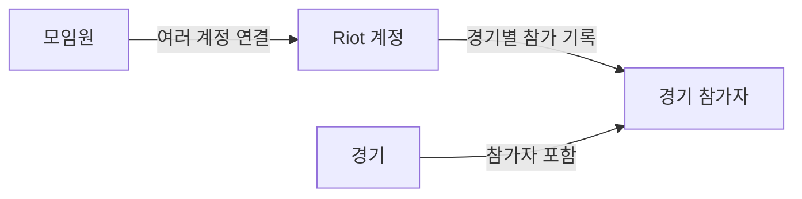

# 내부 구조

[문서 목록](README.md) · [개발·테스트](development.md)

LLVY는 Next.js의 화면·서버 기능과 PostgreSQL을 사용합니다.
원본 리플레이는 Vercel Blob에 보관하며 Redis는 조회와 자동완성의 선택적 캐시입니다.

## 코드 위치

| 위치                                                                                                                 | 역할                           |
| -------------------------------------------------------------------------------------------------------------------- | ------------------------------ |
| [`src/app/`](../src/app/)                                                                                            | 화면, Server Actions, API      |
| [`src/db/schema.ts`](../src/db/schema.ts)                                                                            | 데이터 모델과 제약조건         |
| [`src/lib/rofl/`](../src/lib/rofl/)                                                                                  | 리플레이 메타데이터 파싱       |
| [`src/lib/ingest.ts`](../src/lib/ingest.ts)                                                                          | 파싱한 경기와 참가자 저장      |
| [`src/lib/member-mutations.ts`](../src/lib/member-mutations.ts), [`game-mutations.ts`](../src/lib/game-mutations.ts) | 권한을 확인한 모임원·경기 변경 |
| [`src/lib/read-model.ts`](../src/lib/read-model.ts)                                                                  | 화면에 필요한 조회 결과 구성   |
| [`src/lib/session.ts`](../src/lib/session.ts)                                                                        | 로그인 세션과 역할 확인        |
| [`src/test/`](../src/test/)                                                                                          | 테스트용 데이터와 공통 설정    |

## 데이터 관계

- 리플레이에서 발견한 Riot 계정은 처음에는 모임원에 연결되지 않습니다. 관리자가 연결합니다.
- 모임원 전적은 현재 연결된 모든 Riot 계정의 경기를 합산합니다. 계정 연결을 바꾸면 과거 전적에도 반영됩니다.
- 제외한 경기는 목록과 통계에서 빠지지만 원본과 기록은 보존되어 복구할 수 있습니다.
- Discord 로그인 계정은 게임 모임원과 별도로 관리합니다. 이름으로 두 계정을 자동 연결하지 않습니다.

구체적인 테이블은 [`schema.ts`](../src/db/schema.ts), 전적 집계는
[`member-history.ts`](../src/lib/member-history.ts)에서 확인할 수 있습니다.

## 업로드 흐름

1. 관리자·오너가 업로드를 시작하면 서버가 파일을 올릴 경로와 업로드 권한을 발급합니다.
2. 브라우저가 원본을 Blob에 직접 업로드합니다.
3. 서버가 업로드 소유권과 현재 사용자 권한을 확인한 뒤 파일을 읽고 파싱합니다.
4. 경기·참가자와 감사로그를 저장합니다. 중복 파일은 기존 경기로 안내합니다.

시작과 처리는 [`src/app/api/`](../src/app/api/), 저장은
[`ingest.ts`](../src/lib/ingest.ts), 미사용 업로드 정리는
[`expired-upload-cleanup.ts`](../src/lib/expired-upload-cleanup.ts)에서 처리합니다.

## 조회와 검색

화면은 조회 모델을 통해 경기·모임원 정보를 읽습니다. 일반 사용자에게는 생년을 전달하지 않습니다.
Redis가 연결되어 있으면 조회 결과와 이름·Riot ID 자동완성 인덱스를 캐시하고,
연결되지 않거나 장애가 나면 PostgreSQL에서 조회합니다.

업무 변경은 같은 트랜잭션에서 PostgreSQL의 관련 `cache_revisions`를 증가시킵니다.
읽기는 현재 권한과 revision을 확인한 뒤 해당 버전의 Redis 결과를 사용하므로,
모임원 목록을 하루 보관해도 회원·계정 변경 이후에는 새 결과를 읽습니다.
전적은 현재 신원, 연결 계정, 전체 통계, 경기 페이지를 나눠 다음 페이지에서 통계를 재사용합니다.
정책 기본값은 비활성이며, migration과 모든 writer 전환 확인 후 활성화합니다.
TTL과 전환·복구 절차는 [Redis 안내](redis.md)를 참고하세요.

검색 제출은 현재 DB의 이름·Riot ID와 계정 연결을 확인합니다. 일치하는 모임원이 한 명이면
전적으로 이동하고, 여러 명이면 선택 목록을 표시합니다.
검색은 [`nickname-search.ts`](../src/lib/nickname-search.ts), 캐시는
[`query-cache.ts`](../src/lib/query-cache.ts)와 [`autocomplete-index.ts`](../src/lib/autocomplete-index.ts)에서 다룹니다.

## 권한과 데이터 변경

- Discord로 신원을 확인하고 지정 서버 가입 여부를 확인한 뒤 앱 세션을 만듭니다.
- 서버의 조회·API·변경 함수가 세션과 역할을 확인합니다. 화면에서 버튼을 숨기는 것만으로 권한을 제한하지 않습니다.
- 데이터 변경 직전에는 권한을 다시 확인하며, 변경과 감사로그를 같은 DB 트랜잭션에 저장합니다.
- 관리자 지정·회수는 [`account-administration.ts`](../src/lib/account-administration.ts),
  변경 작업의 공통 권한 확인과 감사는 [`audit.ts`](../src/lib/audit.ts)에서 처리합니다.

사용자 역할과 로그인 설정은 [Discord 안내](discord-auth.md),
기능별 요구사항은 [OpenSpec](../openspec/README.md)을 참고하세요.
