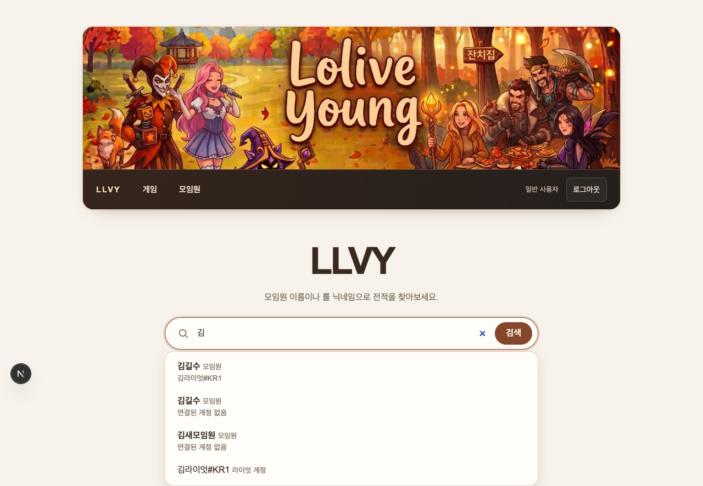

# 2026-10-10 모임원 이름 검색

[변경 계획](../../openspec/changes/add-member-name-search/) · [검색과 캐시 계약](../valkey.md)

## 구현

메인 `q` 검색에서 모임원 이름과 저장된 Riot ID를 함께 추천한다. 이름은 계정·전적 없는 모임원도
포함하며 후보 종류를 구분하고 연결 계정을 최대 2개 표시한다. 직접 제출은 현재 DB에서 정확 일치한
모임원을 UUID로 합친 뒤 20명씩 페이지를 나눈다. 기존 `nickname` 검색과 API 응답은 유지한다.
이름 후보의 상세 이동은 통계 캐시와 별도로 현재 이름·존재를 확인한다. 생년은 검색에 포함하지 않는다.

## 자동 회귀

실제 migration을 적용한 PGlite에서 이름·Riot 충돌, 한 모임원의 계정 25개, 동명이인 43명,
계정·전적 없는 모임원, 모든 역할의 최소 투영, 현재 연결·이름·삭제, DB 오류 전파를 확인했다.
입력·API·클라이언트·SSR 회귀는 Unicode·반복/혼합 파라미터, 기존 응답 호환, 200ms debounce,
취소·오래된 응답 무시, 후보 검증·경로 생성, 페이지 링크·HTML escaping을 검사한다.

실제 로컬 Valkey 9의 query-cache 회귀 36개가 통과했다. 두 인덱스 분리·cold/warm·TTL·부분 eviction·
손상된 값·DB 대체·커밋 후 변경·롤백·동시/늦은 구축·세션 폐기와 관리자 회수 후 거부를 포함한다.
새 이름 인덱스는 `member-autocomplete:v1`, 기존 Riot 인덱스는 `autocomplete:v1`이다.

```bash
VITEST_MAX_WORKERS=4 \
LLVY_VALKEY_TEST_URL=redis://127.0.0.1:16379 \
LLVY_REPLAY_FILE=/Users/gilsu/Downloads/TalkFile_KR-8390006818.rofl \
VALKEY_URL='' npm run check
OPENSPEC_TELEMETRY=0 openspec validate add-member-name-search --strict
```

전체 검사는 42개 파일 중 41개 실행, **750개 통과·3개 건너뜀**이다. 건너뛴 3개는 별도
`LLVY_POSTGRES_TEST_URL`을 요구하는 기존 인증 동시성 검사다. ESLint·TypeScript·Next.js 16.3.8
production build·Prettier와 이 변경의 OpenSpec strict 검증을 통과했다.
실행 로그는 `/private/tmp/llvy-member-search-check.log`에 남겼다.

## 로컬 브라우저

현재 소스를 `/private/tmp/llvy-member-search-browser`에 복사하고 DB 연결 어댑터만 `pg`로 바꿔
격리된 PostgreSQL 17 `llvy_search_test`와 Valkey 9에 연결했다. 검색·페이지·인증 코드는 실제 소스이며
테스트용 DB 계정과 서명된 세션 쿠키를 사용했다. Discord OAuth 로그인을 수행한 것은 아니다.
Playwright로 설치된 Chrome의 독립 프로필을 실행했으며, 다음 12개 흐름을 확인했다.

1. 한글 이름·Riot 후보의 종류 표시와 생년 미포함.
2. 이름 포인터 선택과 전적 없는 모임원 화면.
3. 방향키·Escape·재열기·Enter로 이름 선택.
4. Riot 후보 키보드 선택과 기존 `nickname` 경유 전적 이동.
5. 이름 전체 직접 제출 시 동명이인 각각 표시.
6. 동명이인 23명의 20명/3명 페이지 이동과 `q` 유지.
7. 합성 composition 이벤트에서 조합 중 Enter의 선택·제출 방지.
8. 자동완성 503 주입 후 안내와 직접 GET 검색 유지.
9. JavaScript를 비활성화한 브라우저의 GET 제출.
10. 추천·전적 캐시가 준비된 뒤 이름을 바꿔도 같은 UUID의 현재 이름 표시.
11. 테스트 캐시 세대를 교체한 뒤 새 이름 후보 재구축.
12. 이미 표시된 이름 후보의 모임원을 삭제하면 기존 ‘찾을 수 없음’ 화면 표시.

브라우저 오류는 없었다. 상태 변경 시나리오는 테스트 DB의 직접 변경과 테스트 세대 교체로 재현했고,
보호된 실제 mutation 함수의 무효화는 위 자동 회귀에서 검증했다. IME 검사는 합성 이벤트이며
운영체제 한글 입력기를 물리적으로 조작한 검증은 아니다. 브라우저 실행 기록은 임시 폴더의
`browser-check.mjs`, `browser-results.json`에 있다.



## 검증 범위

로컬 테스트이며 운영 검증이 아니다. 실제 Discord·Neon·Layerbase TLS·Vercel Blob/Cron·운영 배포는
수행하지 않았다. 실제 리플레이 바이트는 로컬에서 읽고 외부 Blob I/O는 기존 모의 구현을 사용한다.
DB schema 변경은 없으며 운영 migration·배포·push는 수행하지 않았다.
검증용 Next 서버와 `llvy-member-search-pg-20261010`, `llvy-member-search-valkey-20261010` 컨테이너는
확인 후 종료·제거했다.
