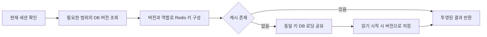

## Context

2026-10-15 작업 트리 기준 조사다. 운영 Redis의 hit ratio, 메모리, 명령 수, 현재 배포의 응답 시간은 이번 계획 작성에서 측정하지 않았다.

| 현재 동작                                                  | 근거                                                                            | 영향                                            |
| ---------------------------------------------------------- | ------------------------------------------------------------------------------- | ----------------------------------------------- |
| 모든 조회와 두 자동완성 인덱스가 60초 만료                 | `src/lib/query-cache.ts:6`, `src/lib/autocomplete-index.ts`                     | 드문 방문마다 DB 재조회·전체 인덱스 재구축 가능 |
| 단일 Redis generation을 모든 데이터가 공유                 | `query-cache.ts:getQueryCacheGeneration`, `invalidateQueryCache`                | 댓글 수정도 회원 검색 인덱스를 버림             |
| 모든 성공한 actor transaction 뒤 전체 무효화               | `src/lib/audit.ts:100`, `src/lib/pending-upload-store.ts:43`                    | 리플레이 저장 전 업로드 예약만으로도 캐시 소멸  |
| 일반 조회의 동시 miss를 합치지 않음                        | `query-cache.ts:cachedQuery`                                                    | 같은 비싼 DB 집계를 여러 요청이 동시에 실행     |
| 자동완성은 프로세스 내부에서만 build 공유                  | `autocomplete-index.ts:127`                                                     | 인스턴스가 다르면 같은 인덱스를 중복 구축       |
| 자동완성 miss 응답이 전체 인덱스 게시까지 기다림           | `autocomplete-index.ts:161`                                                     | 조회 비용에 Redis 쓰기 비용까지 추가            |
| 전적 집계와 페이지가 하나의 캐시 항목                      | `read-model.ts:getMemberHistoryReadModel`, `member-history.ts:getMemberHistory` | 다음 페이지에서 전체 집계를 다시 계산·저장      |
| warm 조회에도 인증 DB 조회, 전적에는 현재 신원 조회가 남음 | `session.ts`, `read-model.ts:121`                                               | Redis hit가 API 전체 DB 비용 제거를 뜻하지 않음 |

60초가 효과 없는 것은 아니다. 같은 키가 1분 안에 반복되는 구간에는 도움이 된다. 다만 변경보다 시간 만료가 더 잦은 사용 패턴에서는 효율이 떨어진다. 예를 들어 변경 없이 같은 키를 5분마다 요청하면 현재 정책은 매번 miss지만, 6시간 보관은 최초 로드 후 재사용할 수 있다. 이는 동작 예시이며 운영 트래픽 추정치가 아니다.

### 추가 변경 재검토 — 2026-10-15

- 경기 목록 참가자 표시가 작업 트리에 완성됐다. `getGameListReadModel`은 `game-list-v2`와 `listGamesWithParticipants`를 사용하고 화면은 10경기씩 표시한다. 참가자 이름은 현재 회원·계정 연결을 조인하므로 `members`, `accounts` 의존성이 필수다.
- 비어 있지 않은 경기 목록 miss는 현재 count 1회, 경기 페이지 1회, 해당 페이지 참가자 1회의 업무 조회를 수행한다. 이미 페이지 단위 일괄 조회이므로 N+1 제거 작업을 새로 만들지 않는다. 빈 페이지의 참가자 조회 생략과 warm cache의 참가자 조회 0회를 보존한다. 이 횟수는 코드와 로컬 검증 기록 기준이며 운영 실측은 아니다.
- `game-detail-v2`는 아이템 슬롯을, `member-history-v2`는 `gameVersion`·본인 레벨/아이템·양 팀 참가자를 포함한다. 캐시를 나눌 때 이 필드와 개인정보 제외 조건을 보존한다. 기존 v1 키 격리 회귀와 현재 v2 형식도 새 namespace 전환의 검증 대상으로 삼는다.
- `champions.ts`의 이름·초상화는 같은 24시간 memo/pending을 공유한다. `game-assets.ts`는 패치별 카탈로그를 성공 시 24시간 보관하고 최대 8개와 2초 조회 제한을 두며, `member-game-assets.ts`는 버전별 그룹을 최대 8개씩 병렬 처리한다. 이 경로는 Redis 업무 결과 캐시 밖에서 실행되므로 카탈로그 cold/warm 상태를 성능 측정에 포함한다.
- 경기 목록의 상세·회원 링크에는 이미 `prefetch={false}`가 적용돼 있다. 실제 탐색과 prefetch 요청을 구분해 측정하고 캐시 작업 중 이 동작을 바꾸지 않는다.

검토 근거는 현재 소스와 `docs/validation/2026-10-15-game-list-participants.md`다. 기록된 기존 테스트 결과는 참고 자료이며 이번 계획 수정에서 다시 실행한 결과가 아니다.

## Goals / Non-Goals

**Goals:**

- 데이터가 바뀌지 않으면 분 단위 방문 간격에서도 캐시를 재사용한다.
- 변경 이후 시작한 읽기는 해당 변경 이전 캐시를 사용하지 않는다. Redis 쓰기 성공에 이 보장을 의존하지 않는다.
- 무관한 변경으로 인한 miss, 중복 집계, 인덱스 재게시와 네트워크 왕복을 줄인다.
- 추가 버전 조회 비용까지 포함해 DB 부하·응답 시간·Redis 사용량을 검증한다.

**Non-Goals:**

- 요청 간 세션·권한 캐싱, 공유 CDN에 인증 응답 저장, 권한 투영 축소.
- Redis 제공자/프로토콜 교체, Next.js Cache Components 전면 전환.
- 첫 단계에서 회원별 모든 역참조를 추적하거나 모든 검색어 결과를 캐시하는 것.
- 이번 계획 단계의 코드 수정, migration 실행 또는 배포.

## Decisions

### 1. TTL과 최신성의 역할을 분리한다

**추천: PostgreSQL 범위별 변경 버전 + Redis 장기 보관.** `cache_revisions(scope PRIMARY KEY, revision BIGINT)`와 캐시 정책의 `epoch`/활성 상태를 둔다. 업무 데이터와 관련 revision을 **같은 DB 트랜잭션**에서 갱신한다. revision은 원자적으로 증가시키며 JSON/키에서는 정밀도 손실 없는 문자열로 다룬다.

읽기 순서는 다음과 같다.

- 한 읽기 작업에 필요한 revision을 한 번의 indexed SELECT로 가져오고, 같은 요청의 동일 범위 읽기는 공유한다. 여러 요청 사이의 revision 메모는 두지 않는다.
- 초기 구현은 인증 경계를 유지하면서 별도의 버전 조회 1회를 명시적으로 허용한다. 전적의 현재 신원 조회와 버전 조회는 안전하게 합칠 수 있으면 합친다. 인증 SQL과의 결합은 계측 후 판단하며 성능 개선을 가정하지 않는다.
- Redis가 없거나 우회 상태라면 캐시용 버전 조회도 생략한다. 버전 조회 실패·정책 비활성·필수 범위 누락 시 기존 캐시를 사용하지 않고 업무 DB를 조회한다. 업무 DB 실패는 그대로 오류다.
- miss 로더가 완료될 때 버전을 새로 붙이지 않는다. 시작 시 r1로 읽은 결과는 r1 키에만 저장된다. 도중 변경이 r2로 커밋되면 이후 요청은 r2를 사용한다.
- 요청 도중 발생한 변경까지 선형화하지는 않는다. 변경과 겹친 요청은 읽기 시작 시점의 결과를 받을 수 있으며, 커밋 후 시작한 요청에는 이전 버전이 사용되지 않는다.
- 전역 epoch를 키에 포함해 복원·캐시 계약 전환 때 과거 revision 번호의 항목이 재사용되지 않게 한다. DB 복원 runbook에도 epoch 교체를 포함한다.
- TTL은 메모리 회수와 재계산 주기를 담당한다. 최신성은 DB revision이 담당하므로 Redis 무효화 명령 실패 후에도 오래된 키를 선택하지 않는다.

비교한 대안:

| 대안                                               | 판단                                                                                                             |
| -------------------------------------------------- | ---------------------------------------------------------------------------------------------------------------- |
| TTL만 60초 → 1시간                                 | 무효화 실패 시 오래된 결과 허용 시간도 1시간으로 늘어나므로 채택하지 않음                                        |
| Redis scope generation + 재시도만 추가             | 프로세스 종료·복구와 여러 인스턴스의 누락을 완전히 해결하지 못함                                                 |
| DB outbox + 항상 실행되는 전달기 + freshness lease | DB 확인을 더 줄일 여지는 있지만 전달기·복구·lease 운영이 추가됨. 현재는 매 요청 인증 DB 조회가 필수이므로 후순위 |
| 매 요청 indexed revision 조회                      | 작은 DB 조회 비용이 추가되지만 비싼 집계와 인덱스 재구축을 생략하면서 최신성을 명확하게 유지할 수 있어 추천      |

### 2. 데이터 의존 관계에 따라 범위를 나눈다

첫 단계는 정확성이 검증 가능한 범위부터 시작한다. `history`는 전체 전적 범위로 유지하되 댓글과 업로드 예약에서는 보존한다. 회원별 전적 revision은 실제 miss 비중이 높을 때 후속 최적화한다.

| 캐시                  | 의존 revision                             |
| --------------------- | ----------------------------------------- |
| 모임원 목록           | `members`, `accounts`                     |
| 모임원 자동완성       | `members`, `accounts`                     |
| Riot 자동완성         | `accounts`, `riot-eligibility`            |
| 닉네임 부분 검색 결과 | `members`, `accounts`, `riot-eligibility` |
| 경기 목록             | `game-list`, `members`, `accounts`        |
| 개별 경기 상세        | `game:<id>`, `members`, `accounts`        |
| 전적 집계             | `history`                                 |
| 전적 페이지           | `history`, `accounts`                     |

회원 신원과 연결 계정은 전적 집계에서 분리한다. 현재 신원 확인·권한별 투영은 유지하며 연결 계정 목록에는 `accounts`를 적용한다. 조회 결과 키에는 현재 DB/환경, 새 schema namespace, epoch, 정렬된 revision 집합, 역할, query 버전, 정규화한 인자를 포함한다. 자동완성 인덱스는 현재처럼 모든 인증 역할에 동일하게 허용된 최소 필드만 저장하므로 역할 간 공유한다.

| 변경                                                           | 증가시키는 revision                                                                                              |
| -------------------------------------------------------------- | ---------------------------------------------------------------------------------------------------------------- |
| 회원 생성·이름/생년 수정                                       | `members`                                                                                                        |
| 회원 삭제                                                      | `members`; 실제 계정 연결이 해제되면 `accounts`, `history`, `riot-eligibility`                                   |
| 계정 연결·해제·이동                                            | `accounts`, `history`, `riot-eligibility`                                                                        |
| 실제 적용된 Riot ID 변경·계정 신규 생성                        | `accounts`                                                                                                       |
| 새 경기 저장                                                   | `game-list`, `game:<id>`, `history`, `riot-eligibility`; 계정 upsert가 표시 데이터를 바꾼 경우 `accounts`도 증가 |
| 경기 제외·복원                                                 | `game-list`, `game:<id>`, `history`, `riot-eligibility`                                                          |
| 경기 날짜 변경                                                 | `game-list`, `game:<id>`, `history`                                                                              |
| 경기 댓글 변경                                                 | `game-list`, `game:<id>`                                                                                         |
| 업로드 예약·인증 감사만 기록·중복 리플레이·실제 변경 없는 요청 | 없음                                                                                                             |

`withActorTransaction`의 반환값에 따른 전체 무효화를 없애고 mutation이 실제 변경 범위를 명시한다. 하나의 트랜잭션에서 scope를 모아 중복 제거 후 일정한 순서로 증가시킨다. 기존 account/authority/business 잠금을 모두 획득한 뒤 revision을 갱신하고, 이후 새 business 잠금을 잡지 않는 순서를 지킨다. 잠금 충돌은 실제 PostgreSQL 다중 연결 테스트로 검증한다.

계정 이름 변경은 다른 회원의 과거 경기 참가자 표시에도 영향을 준다. 이를 놓치지 않도록 첫 단계에서는 `accounts`를 해당 DTO 전체의 공통 의존성으로 사용한다. 현재 경기 목록은 연결된 참가자의 모임원 이름을 표시하므로 회원 이름 수정·삭제 및 계정 연결·해제·이동도 active/excluded 목록 양쪽에 반영한다.

### 3. 초기 TTL 정책

다음 값은 **현재 revision을 확인하는 경로의 보관 정책**이다. 모임원 목록은 정확히 24시간(86,400초)으로 고정하고 jitter를 적용하지 않는다. 정상 hit는 expiry를 연장하지 않는다. 나머지 양수 결과 정책은 최초 저장 시 ±10% jitter를 적용하며 null은 별도 정책을 쓴다.

| 데이터                                  | 기본 TTL | 이유                                      |
| --------------------------------------- | -------- | ----------------------------------------- |
| 모임원 목록(포함된 연결 계정 정보 전체) | 24시간   | 변경은 revision으로 즉시 반영             |
| 전적 화면의 분리된 연결 계정 목록       | 30분     | 모임원 목록 스냅샷과 별도 정책            |
| 경기 목록                               | 30분     | 페이지 키 수와 메모리 제한                |
| 경기 상세                               | 6시간    | 저장 후 대부분 고정, 수정은 revision 반영 |
| 회원 전적 집계                          | 1시간    | 페이지와 독립적으로 비싼 전체 집계 재사용 |
| 회원 전적 페이지                        | 30분     | 페이지별 참가자 결과와 메모리 균형        |
| 모임원/Riot 자동완성 전체 인덱스        | 6시간    | 시간 경과만으로 전체 재구축되는 빈도 축소 |
| 닉네임 부분 검색 결과                   | 5분      | 임의 검색어의 낮은 재사용·키 증가 고려    |
| 존재하지 않는 단일 리소스 `null`        | 30초     | 반복 오타는 흡수하되 키 보관은 짧게       |

인덱스의 names/hash/ready에는 **동일한 한 번의 만료 시각**을 적용한다. 빈 전체 인덱스도 유효한 스냅샷이며 같은 정책을 따른다. 임시 build 키와 lock은 데이터 TTL과 분리해 짧게 정리한다.

모임원 목록의 24시간은 변경이 없을 때의 보관 시간이다. 이름·생년·계정 연결·Riot ID가 바뀌면 해당 revision을 사용하는 새 결과를 바로 읽는다. `members`·`accounts`에 의존하는 목록 전체의 역할별 캐시 분리를 유지하고 네 로그인 역할 모두 기존 모임원 생년을 조회한다. `add-uploader-role`의 projection 버전을 합성해 이전 viewer 생년 제외 캐시를 사용하지 않는다. 모임원 자동완성은 별도의 6시간 인덱스 정책을 유지한다.

처음부터 다른 revision의 이전 결과를 반환하는 SWR은 도입하지 않는다. 같은 revision에서만 유효한 결과를 활용하고, 만료 직전 재게시가 필요하면 계측 후 추가한다. 삭제·연결 변경의 오래된 결과를 성능 목적으로 다시 노출하지 않는다.

### 4. 중복 로딩과 게시 대기를 줄인다

- 일반 조회에 bounded `Map<fullCacheKey, Promise>`를 두어 동일 인스턴스의 동시 miss를 합친다. 성공·실패 모두 finally에서 제거하고, 반환 객체 공유로 호출자 간 변경이 전파되지 않게 한다.
- 프로세스 간 조정은 전체 스냅샷 비용이 큰 자동완성부터 적용한다. full version key별 `SET NX PX` lease와 임의 owner token을 사용하고, 게시·해제는 token 소유권을 원자적으로 확인한다. lease가 만료된 오래된 작업은 후속 소유자의 인덱스를 덮어쓰지 못한다.
- 잠금 대기는 초기 50ms 이내로 제한한다. 기다린 뒤 결과가 없으면 동일 프로세스의 fallback 로딩을 합쳐 DB 결과를 반환한다. 이 경우 여러 인스턴스의 중복 DB 조회는 허용하며, 장애 상황에서 정확히 한 번의 재구축을 보장한다고 주장하지 않는다.
- 기존 100ms 연결·준비·명령 제한과 5초 cooldown은 유지한다. 추가 왕복과 lock 대기가 누적되지 않도록 Redis 읽기·연결·lease 조정 대기에는 총 150ms 예산을 둔다. 인증·revision·업무 DB 실행 시간은 이 예산에 포함하지 않으며 별도로 측정한다. 전체 API 응답 150ms를 보장하는 수치가 아니다.
- 자동완성 miss의 DB 결과를 확보하면 인덱스 게시를 `after()`로 이어서 응답을 먼저 보낼 수 있게 한다. Next.js 요청 경계에서 lifecycle callback을 주입하고 일반 라이브러리에 미완료 Promise만 남기지 않는다. callback에는 이미 검증된 최소 DTO·버전·owner token만 전달한다. 게시 중에는 build 상태를 유지한다.
- background 실행이 실패하거나 프로세스가 끝나도 다음 요청이 다시 만들 수 있어야 한다. correctness는 revision에 있고 `after()` 성공에 있지 않다. 테스트/스크립트 등 lifecycle이 없으면 awaited publication을 사용한다.

lease는 캐시 중복 작업을 줄이기 위한 수단이다. 업무 쓰기 권한이나 DB 일관성을 보호하는 잠금으로 사용하지 않는다. Redis의 [lock 소유권 확인 방식](https://redis.io/docs/latest/develop/clients/patterns/distributed-locks/)을 참고하되 서버 버전에 맞는 `SET NX PX`와 Lua 비교를 사용한다.

### 5. 조회 비용과 키 수를 줄인다

- `getMemberHistory` 내부를 현재 신원/연결 계정, 전체 집계, 페이지 경기·참가자로 나눈다. 현재 `member-history-v2`의 `gameVersion`, 본인 `level`·7개 `items`, 양 팀 `participants`·`isMember`를 그대로 보존한다. 본인 loadout만 최소 필드로 읽고 다중 계정 참가 시 모호한 값을 만들지 않는 규칙도 유지한다. 전체 연결 계정 기준 통계는 페이지를 바꿔도 재실행되지 않아야 한다.
- revision을 DB에서 확인하므로 일반 warm 조회의 Redis generation GET을 제거할 수 있다. 자동완성 두 소스의 revision은 한 번에 읽고, 독립적인 인덱스 조회는 한 pipeline에 묶는 방안을 검증한다. pipeline은 원자성을 제공하지 않으므로 인덱스 무결성은 기존 Lua 검증이 담당한다. [Redis pipelining 문서](https://redis.io/docs/latest/develop/using-commands/pipelining/)의 왕복 감소 원칙을 따른다.
- 페이지 크기·offset·정규화 검색어를 실제 DB 로더와 같은 규칙으로 canonicalize한다. 경기 목록의 화면 크기 10과 전적의 25를 유지한다. 경기 목록은 visibility별 cached count로 확정한 실제 페이지를 키로 사용해 과도한 requestedPage가 동일 마지막 페이지 키로 합쳐지게 한다. `listGamesWithParticipants`의 페이지 먼저 선택 → 최소 참가자 1회 조회를 재사용한다.
- 결과당 256KiB 제한을 유지한다. 오래된 버전 키는 TTL로 회수하고 전체 `KEYS`/전역 flush를 사용하지 않는다. 페이지 깊이별 캐시 admission을 도입해 첫 20페이지를 초기 캐시 대상으로 삼고, 그 밖의 페이지는 같은 DTO의 DB 결과를 반환한다.
- 검색어별 캐시의 실제 호출 여부와 재사용률을 먼저 확인한다. 이득이 없으면 해당 결과 캐시를 끄고 두 전체 자동완성 인덱스에 집중한다. 인덱스 크기·build 시간·최대 메모리 예산도 측정해 상한 초과 시 게시를 생략한다.
- 조회 결과의 역할별 키는 유지한다. 객체 구조가 우연히 같다는 이유로 admin/owner/uploader/viewer 항목을 합치지 않는다. 이미 역할 공통 최소 투영으로 정의된 자동완성 인덱스는 기존 공유를 유지한다.

이름/초상화/아이템 URL을 업무 Redis DTO에 새로 넣지 않는다. Redis는 현재처럼 내부 champion·item ID·gameVersion 등 투영된 업무 값만 보관하고 카탈로그 조회는 별도 수명으로 유지한다. 기존 이름·초상화 공동 로딩과 패치별 카탈로그 공유를 재구현하지 않는다. 카탈로그 공통화나 Redis 이관은 실제 중복 fetch 비용이 확인될 때 별도 변경으로 검토한다.

### 6. 계측과 합격 기준

`auth_ms`, `revision_ms`, `redis_connect_ms`, `cache_read_ms`, `db_load_ms`, `index_build_ms`, `index_publish_ms`, `asset_lookup_ms`, `cache_outcome`, `asset_cache_outcome`, `coalesced`, `payload_bytes`를 query 종류별로 기록한다. 검색어·이름·쿠키·연결 문자열·회원별 ID를 metric label로 사용하지 않는다. API는 비민감 `Server-Timing`, 페이지는 서버 span을 사용한다. Redis warm/카탈로그 cold와 양쪽 warm을 구분하고 브라우저의 실제 이미지 로딩은 서버 카탈로그 조회와 별도로 측정한다.

| 검증                    | 합격 기준                                                                                                                     |
| ----------------------- | ----------------------------------------------------------------------------------------------------------------------------- |
| 유휴 재방문             | 데이터 변경 없이 2분·10분 뒤 재조회해도 각 정책 TTL 내에서 업무 로더 재실행 0회; 인증/버전 조회는 별도 집계                   |
| 무관한 쓰기             | 댓글 수정·업로드 예약 후 두 자동완성 인덱스의 DB 로더 재실행 0회                                                              |
| 변경 직후               | 커밋 후 시작한 요청은 새 이름·연결·제외 상태를 사용; Redis 쓰기 차단·복구 후에도 동일                                         |
| 같은 프로세스 동시 miss | 같은 키 20개 요청의 업무 로더 1회; 오류는 공유 후 다음 요청에서 재시도                                                        |
| 여러 프로세스 build     | 정상 lease 기간에는 게시자 1개; lease 만료·프로세스 종료 후 복구, fallback 중복은 별도 측정                                   |
| 전적 페이지 이동        | 1페이지 이후 2페이지에서 전체 집계 로더 재실행 0회                                                                            |
| 모임원 하루 보관        | 변경 없이 24시간 직전까지 재사용하고 24시간 경계에서 만료. 읽기는 만료를 연장하지 않음. 중간의 회원·계정 변경은 즉시 반영     |
| 참가자 목록 보존        | 10경기 페이지, 페이지 참가자 조회 최대 1회, 빈/warm 페이지의 참가자 조회 0회. 이름·연결 변경은 active/excluded 목록 양쪽 갱신 |
| 에셋·투영 보존          | 이름·초상화 공동 로딩, 24시간 카탈로그 및 최대 8개 제한, recorded patch 선택, 2초 실패 fallback과 기존 v2 필드 유지           |
| 호환성과 보안           | 역할 격리, 권한 폐기, 삭제, 검색 정렬/Unicode/legacy DTO, partial eviction 모두 통과                                          |
| 성능·비용               | 동일 fixture·요청 패턴으로 기준선 대비 업무 DB 로더 80% 이상 감소를 목표로 검증. warm 전체 p95가 5% 넘게 악화되면 확대 중단   |

비율 목표는 검증용 workload 목표이며 운영 개선 보장이 아니다. 드문 방문, 연속 검색, 쓰기 직후, 동시 miss, Redis 중단을 분리한다. p50/p95와 표본 수를 같이 남기고, 키 수·메모리·명령 수를 비용 지표로 함께 기록한다. 운영 적중률 목표는 기준선 이후 정한다.

24시간 경계는 제어 가능한 시계로 검증하고, 실제 Redis에서는 초기 TTL이 86,400초 정책으로 저장되는지 별도 확인한다. 테스트를 하루 동안 대기시키지 않는다. 기존 Redis 통합 테스트의 `ttl >= 58` 단정은 모든 항목에 일괄 치환하지 않고, 해당 정책과 legacy 60초 전환 경로를 구분해 갱신한다.

## Risks / Trade-offs

- 버전 조회 왕복이 이득을 상쇄할 수 있음 → 총 응답 시간으로 평가하고, 요청 내 배치·현재 신원 조회 통합을 우선한다. revision 확인을 임의의 짧은 TTL로 바꿔 최신성 보장을 약화하지 않는다.
- 빠진 writer가 오래된 캐시를 만들 수 있음 → 서비스 mutation·ingest·관리 스크립트·공유 DB를 쓰는 preview를 모두 조사한다. 직접 SQL 변경은 revision도 같은 트랜잭션에서 갱신하거나 캐시 정책을 먼저 비활성화하는 runbook이 필요하다.
- revision 행이 쓰기 잠금 경합을 추가 → scope 정렬과 기존 잠금 순서를 고정하고 실제 PostgreSQL에서 교차 변경을 재현한다.
- `history`가 아직 전체 단위임 → 최초 단계의 명시적 절충이다. 데이터 변화가 드문 환경에서 안정성을 우선하고, 계정 이동·상대 참가자 표시까지 검증한 뒤 회원 단위로 세분화한다.
- 긴 TTL로 과거 generation 데이터가 누적 → admission, byte 제한, TTL, 실제 메모리 계측으로 제한한다. 메모리 압박이 있으면 TTL과 캐시 대상부터 줄인다.
- background 게시가 누락될 수 있음 → 캐시 효율만 떨어지도록 설계하며 revision과 DB fallback은 독립적으로 동작시킨다.
- 현재 목록·전적 UI 계약과의 회귀 → 완료된 `game-list-v2`, `game-detail-v2`, `member-history-v2` 회귀를 기준으로 삼고, 새 namespace가 이전 형태의 항목을 읽지 않도록 검증한다.

## Migration Plan

1. **P0 — 기준선과 빠른 개선:** 계측, 일반 조회 single-flight, 업로드 예약의 불필요한 무효화 제거. 이 단계는 기존 60초 TTL을 유지한다.
2. **P1 — 변경 버전과 신뢰성:** additive migration, mutation별 scope 기록, revision 기반 새 namespace 읽기, 실패·동시성 회귀. 캐시 정책은 기본 비활성으로 배포한다. 기존 60초 캐시를 쓰는 배포가 공존하는 동안 기존 무효화도 병행한다.
3. **P1 — 전환 검증:** 모든 active writer가 revision을 기록하는지 검증하고 이전 배포/작업이 더 이상 쓰지 않는 상태를 확보한다. 확인 불가능하면 장기 캐시를 켜지 않는다. 검증 환경에서 정책별 TTL을 확인한 뒤 epoch를 교체하고 새 읽기를 활성화한다. 현재 활성화 스위치는 업무 캐시 전체에 적용한다.
4. **P2 — 효율:** 전적 집계 분리, 두 인덱스 pipeline, lease, 응답 후 게시, admission을 순차 적용하고 각 단계의 개선 여부를 측정한다.
5. **검증/운영:** 실제 Redis + 실제 PostgreSQL, `npm run check`, `openspec validate --all --strict`, 해당 커밋의 인증된 배포 smoke와 반복 측정을 수행한다. 로컬 성공을 운영 증거로 대체하지 않는다.

운영 DB 변경은 backup/disposable branch 검증과 강제 rollback 검증 후 고정 migration을 적용한다. 코드 rollback 전에는 DB 정책을 먼저 비활성화하여 새 캐시 읽기를 우회하고, schema는 보존한다. 다시 활성화할 때 epoch를 바꾼다. 이전 코드의 Redis generation 캐시가 남아 있을 수 있으므로 이전 읽기로 복귀할 때 해당 namespace를 교체하거나 이전 TTL 만료를 확인한다.

## Open Questions

구현 전 계측·환경 확인으로 해결할 항목이며 계획 작성의 차단 사유는 아니다.

- 운영 요청 간격, query별 재사용률, Redis RTT/명령 수/메모리와 provider 요금 모델.
- version SELECT 1회를 추가한 실제 end-to-end 비용과 현재 신원 조회 통합 가능성.
- 실제 인덱스 크기와 build p95에 맞는 lease 기간·메모리 상한. 초기 대기 예산은 유지하며 lease 기간은 측정으로 확정한다.
- 현재 또는 과거 배포·관리 도구·preview가 운영 DB에 쓰는 경로와 안전한 전환 창.
- 카탈로그 cold 상태가 차지하는 실제 지연 비율과 Redis 개선 이후 남는 병목. 현재 경기 목록 DTO 및 `members`·`accounts` 의존성은 이번 재검토로 확정했다.

Next.js 관련 설계는 설치된 `node_modules/next/dist/docs/01-app/03-api-reference/04-functions/after.md`와 `01-app/02-guides/authentication-with-cache-components.md`를 확인했다. 현재 `next.config.ts`는 Cache Components를 활성화하지 않으며 이 계획도 활성화를 요구하지 않는다.
